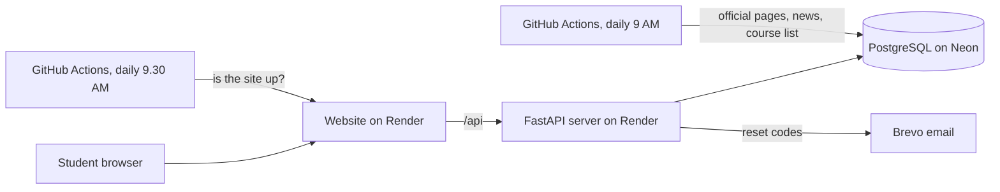

# PathMithra

**Your friend for the path after Intermediate.** A career guidance platform for students in Andhra Pradesh and Telangana: choose an area, a course and a career, then follow a year-by-year path, see what is changing in that field, and track your progress.

🌐 **Live:** https://pathmithra.onrender.com
*(Hosted on a free plan: the first visit after a quiet period can take 30 to 50 seconds while the server wakes up.)*

---

## What it does

- **Explore by area → course → career → path.** 18 areas, from Engineering and Medicine to Law, Design, Agriculture and Polytechnic.
- **655 official course names** from the AP and Telangana admission lists (DOST, OAMDC, EAPCET, ECET, LAWCET, KNRUHS, SBTET and ITI), each linked to one of **101 course pages**, and every course leads to a career path.
- **37 career roadmaps**, step by step for every year of the course, with a small "try this" task for each step.
- **Eligibility check** against official rules for the student's Intermediate subjects. Where a rule is not confirmed on an official page, the site says so instead of guessing.
- **What's changing:** official changes and daily news for every career, such as new licences, standards and government schemes.
- **88 skills** with free official places to learn (SWAYAM, NPTEL, Skill India), plus a personal skill gap.
- **My Path:** next steps, a progress tracker with milestones and a weekly chart, a private learning diary, skills, and opportunities.
- **Accounts:** sign up with a username and a career path; progress syncs across devices; forgot password and username by email.
- **Tools:** a quiz, compare courses, compare careers, a scholarships list, and a Career Assistant that answers only from checked records.

## Built with

| Part | Technology |
|---|---|
| Website | React 19, TypeScript, Tailwind CSS, Vite |
| Server | Python, FastAPI, SQLAlchemy, Alembic |
| Database | PostgreSQL (Neon) |
| Hosting | Render (website and server), Neon (database), Singapore region |
| Automation | GitHub Actions (daily update and daily uptime check) |
| Email | Brevo SMTP |
| Tests | pytest, 354 automated tests |

## How it works



**It runs by itself:**
- **Every day at 9:00 (India time):** checks 25 official websites for changes, collects career news, syncs the official Telangana course list, and tidies old alerts.
- **Every day at 9:30:** checks that the site and its data are up, and emails the owner if not.
- **On every change pushed to GitHub:** Render rebuilds and goes live automatically. A failed build never replaces the working version.

## Trust and accuracy

- Every record names its **official source** and when it was last updated.
- Students only see **published** records. New or unconfirmed records stay hidden until checked.
- Official page changes create an alert only when they look important (notifications, eligibility, dates, fees). Small changes such as visitor counters are ignored.
- Roadmaps are general guidance, and the site says so. Admission rules should always be confirmed on the official website.

## Security and privacy

- Passwords hashed with **Argon2**; login, sign-up and recovery are **rate limited**.
- **One-time reset codes**: only a hash is stored, they expire in 30 minutes and allow 5 tries; a reset logs the account out everywhere.
- The recovery pages give the same answer whether or not an email has an account.
- The email is used **only for recovery** and never shown to others; students log in with a username.
- Requests from other websites are refused (origin and custom-header checks); session cookies are HTTP-only.
- Progress and the diary are private to the student and deleted with the account. Admin pages never show them.
- Secrets live only in the hosting settings, never in the code. Library versions are locked (`backend/requirements.lock`).
- See [docs/PRIVACY-PLAN.md](docs/PRIVACY-PLAN.md) for the plan under India's DPDP Act, including parent consent for under-18 students.

## Run it on your computer

Requirements: Python 3.12, Node.js 20+, PostgreSQL.

```bash
# Server
cd backend
python -m venv venv
venv\Scripts\activate            # Windows (Linux/macOS: source venv/bin/activate)
pip install -r requirements.txt
copy .env.example .env           # then set DATABASE_URL
alembic upgrade head
python -m scripts.seed_reference
python -m scripts.seed_content
python -m scripts.seed_journey
uvicorn app.main:app --port 8001
```

```bash
# Website (in a second terminal)
cd frontend
npm install
npm run dev                      # opens on http://localhost:5173
```

```bash
# Tests
cd backend
python -m pytest
```

On the owner's Windows laptop, `Start CareerPath.bat` starts everything, and a scheduled task keeps it running.

## Project structure

```
backend/
  app/            FastAPI server: API routes, models, eligibility, assistant, page watcher, mailer
  alembic/        database migrations
  scripts/        data (courses, roadmaps, skills, sources) and the daily jobs
  tests/          354 automated tests
frontend/
  src/pages/      Home, Explore, My Path, Account, Admin and more
  src/components/ progress tracker, diary, skill gap, compare and more
docs/             architecture, database, privacy plan, coverage notes
render.yaml       Render hosting setup
.github/workflows daily update and uptime check
```

## More documents

- [Architecture and data sources](docs/ARCHITECTURE.md)
- [Database design](docs/DATABASE.md)
- [AP and Telangana coverage](docs/AP-TS-COVERAGE.md)
- [Privacy plan](docs/PRIVACY-PLAN.md)

## About

Built by **Sompalli Rupa Sree**, B.Tech CSE (Cyber Security), Madanapalle Institute of Technology and Science, with AI-assisted development (Claude Code).

Information on this site is general guidance. Always confirm admission rules and dates on the official websites.
